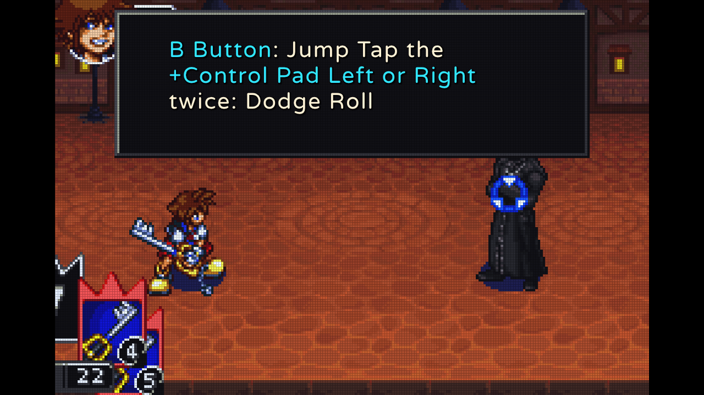
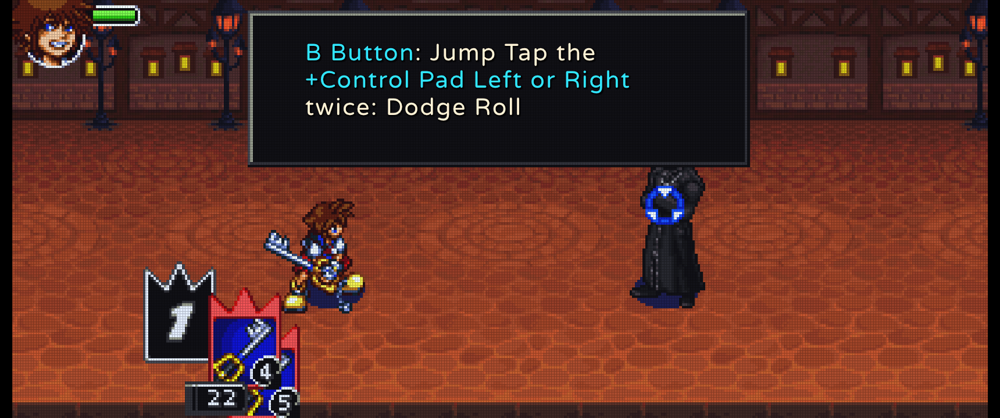
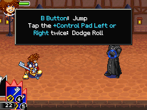
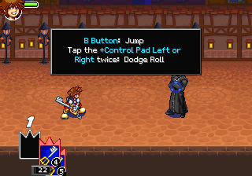

# KHCOMRecomp: Kingdom Hearts: Chain of Memories (GBA) static recompilation

[](https://github.com/rafadono/KingdomHeartsChainOfMemoriesRecomp)
[](https://ko-fi.com/rafadono)

> [!NOTE]
> **Status: Beta / work in progress.** The game is playable end to end with the options below, which are covered by
> automated tests (native C++ unit tests and a Python schema/algorithm suite) and by a headless capture harness.
> Options keep being tuned. Bug reports and feedback are welcome.

Native static recompilation of **Kingdom Hearts: Chain of Memories** (Game Boy Advance, USA release) to PC, built on the
[`gbarecomp`](https://github.com/mstan/gbarecomp) framework. The ARM/Thumb code of the ROM is translated ahead of time into C++
(`generated/`, committed) and linked with the `gbarecomp` runtime, the `recomp-ui` launcher / in-game menu and the reusable
[`gba-improvements`](https://github.com/rafadono/gba-improvements) library (video, audio and input enhancements).
**No game data is distributed**: you need your own legally obtained ROM and (optionally) GBA BIOS.

Documentation map: [docs/ARCHITECTURE.md](docs/ARCHITECTURE.md) (source tree and data flows),
[docs/GBA_IMPROVEMENTS_INTEGRATION.md](docs/GBA_IMPROVEMENTS_INTEGRATION.md) (how the library is wired in),
[docs/TEXT_OVERLAY_ENGINE.md](docs/TEXT_OVERLAY_ENGINE.md) and [docs/TEXT_OVERLAY_RENDER.md](docs/TEXT_OVERLAY_RENDER.md) (HD dialogue text),
[docs/CAPTURE_HARNESS.md](docs/CAPTURE_HARNESS.md) (headless capture and scripted input),
[AGENTS.md](AGENTS.md) (build/test rules for contributors).

---

## ROM and BIOS

### Game ROM

| | |
|---|---|
| Game ID | `B8CE` (USA, NTSC-U) |
| SHA-1 | `10729bd884f8fdca7a310b6d606c52e46657aa48` |
| Size | 33,554,432 bytes (32 MB) |
| Save type | EEPROM, 8 KB |

Put the file in `roms/`. The launcher reads the path from [game.toml](game.toml) (`[rom] path`); with `--rom <file>` any file
name works. Verify the hash (PowerShell / Linux):

```powershell
Get-FileHash -Algorithm SHA1 "roms\<your rom>.gba"
```
```bash
sha1sum "roms/<your rom>.gba"
```

(The `gba-improvements` library also ships a `verify_rom_hash <file> <sha1>` tool, but this repository does not build it:
`GBAIMP_BUILD_TOOLS` is off for the subproject. Enable it with `-DGBAIMP_BUILD_TOOLS=ON` in your own CMake configure if you want it.)

### GBA BIOS (optional but recommended)

- File: `bios/gba_bios.bin` (or any file passed with `--bios`; the repository layout also uses `bios/gba (W).gba`).
- Size 16,384 bytes, SHA-1 `300c20df6731a33952ded8c436f7f186d25d3492`.

---

## Requirements, build and run

Requirements: a C++20 compiler (MSVC 2022 on Windows, GCC/Clang on Linux), CMake 3.20+, Ninja, SDL2 (Linux: `libsdl2-dev`; Windows:
downloaded automatically into `third_party/sdl2` by `build.ps1`), Python 3 (tests and tools), git submodules:

```bash
git clone --recursive https://github.com/rafadono/KingdomHeartsChainOfMemoriesRecomp.git
# or, in an existing clone:
git submodule update --init --recursive      # gbarecomp, external/recomp-ui, external/gba-improvements
```

`generated/` and `generated_bios/` (the recompiled game and BIOS) are committed, so building does not need the ROM.

### Windows (MSVC)

```powershell
.\build.ps1 -BuildDir build-vs                                  # KHCOMRecomp.exe + SDL2.dll in the repository root
.\build.ps1 -BuildDir build-vs -Target khcom_unit_tests         # optional: unit-test executable
.\KHCOMRecomp.exe                                               # launcher (reads game.toml)
.\KHCOMRecomp.exe --rom "roms\<your rom>.gba" --bios "bios\gba (W).gba"   # skip the launcher
```

`build.ps1` finds Visual Studio's CMake/Ninja, configures `Ninja Multi-Config` and copies the result to the root. `-BuildDir`
keeps the Windows cache apart from the Linux one (`build-vs` vs `build`). `-Recompile` re-runs the static recompiler on the ROM
(regenerates `generated/`, normally not needed), `-BuildRecompiler` builds only `gba_recompile`.

### Linux

```bash
docker build -t khcom-builder docker/                           # once (Ubuntu 24.04 + toolchain + SDL2 headers)
docker run --rm -v "$PWD:/src" -w /src khcom-builder bash -c \
  "cmake -S . -B build -G Ninja -DCMAKE_BUILD_TYPE=Release && cmake --build build --config Release"
./KHCOMRecomp                                                   # copied from build/ by the post-build step
```

On a host with the dependencies installed (`build-essential cmake ninja-build libsdl2-dev python3`) `./build.sh --config Release`
does the same without Docker (`./build.sh --help` lists the options). The exact verification commands used by contributors
(build, `cmp`, tests) are in [AGENTS.md](AGENTS.md).

### Tests

```bash
./build/khcom_unit_tests && python3 tests/test_runtime_functions.py        # Linux / Docker
```
```powershell
.\build-vs\Release\khcom_unit_tests.exe; python tests\test_runtime_functions.py   # Windows
```

`khcom_unit_tests` runs every native suite (library integration, HUD zones, widescreen view modes and return to the original 3:2
state, music hook, dialogue backlog, capture harness, HD text overlay render and engine tests). `tests/test_runtime_functions.py`
checks the settings schema and the algorithms in Python; it rewrites `keybinds.ini` line endings, so run `git checkout -- keybinds.ini`
afterwards. CI (`.github/workflows/ci.yml`) builds both platforms and runs the Python suite only; the native unit tests are run locally.

---

## In-game settings overlay

Press **`Escape`** (keyboard) or **`Guide` / `Home` / `Menu`** (gamepad) at any time to open or close the settings menu (built with
`recomp-ui`). Changes apply immediately and are saved to `khcom_config.ini` in the working directory (key bindings to `keybinds.ini`).
The menu window can be **moved by dragging its header** with the mouse (double-click the header to centre it again; the position
is kept until the program exits). The "RESUME" row of the stock menu is removed.

Sections: Display and Graphics (resolution, filters, view mode, upscaler, frame rate), Audio, **Dialogue Text (HD)**, Dialogue & Story,
Controller (Gamepad), Keyboard Controls, Gameplay & Assist, Diagnostics & HUD, System. The view mode is chosen in Display:
an aspect preset (`3:2 (Original)`, `16:10`, `16:9`, `21:9`, `32:9`); the wide presets only affect battles. A separate
**Battle View Height** row adds rows above and below the arena (`4:3`, `5:4`, `10:7`) or follows the window (see below).

---

## Features

### View modes and widescreen (battles only)

| Original 3:2 | 21:9 (373x160 logical) |
|---|---|
|  |  |

Aspect presets come from the `view_aspect` module of gba-improvements: 3:2 (original), 16:10, 16:9, 21:9 and 32:9 (logical widths 240, 256, 284, 373 and 569 at
160 lines; the cap is 640 in `game_config.cpp` and `game.toml`). The launcher also offers an adaptive mode that follows the window.

- **`3:2 (Original)`**: the original 240x160 picture, letter/pillar-boxed. The game behaves exactly as the original: switching back
  to 3:2 (even in the middle of a battle) removes every widescreen provider and HUD displacement and resets the PPU policy globals
  to the faithful values (the policy is the `Widescreen` module of gba-improvements, configured by `src/widescreen_adapter.cpp` and covered by the *view-mode return-to-original* test).
- **Wide presets (`16:10` ... `32:9`)**: a wider picture **only while a battle arena is shown**. Field maps, menus, the title screen and story
  cutscenes stay 3:2 with black pillars (no blur or stretched fill: when the game has nothing real to show there, the picture stays original). During battles the BG2/BG3 arena backgrounds reveal real extra scenery and the HUD (player
  portrait/HP top left, card deck bottom right) is shifted into the corners by exactly the real extra width of each side. **HUD
  anchoring is not a separate option** (the old `hud_anchoring=` line in `khcom_config.ini` is accepted and ignored).
- Sprites keep their 1:1 pixel aspect at all times: no stretched "fat Sora".

Limits of the real artwork: the arena backdrop is a 512x512 image, so the width that shows real scenery is bounded by the artwork of each arena
(about 416 px wide in the arena measured so far), not by gbarecomp, whose engine capacity is 1280x864. A preset wider than the artwork shows its edge.

#### Taller battle view (vertical extension)

| 4:3 (240x180) | 10:7 (320x224) |
|---|---|
|  |  |

The **Battle View Height** setting (`battle_view` in the `[Video]` section of `khcom_config.ini`) makes the battle arena taller than 160 lines:

| Value | Logical view | Notes |
|---|---|---|
| `0` Off | 240x160 (or the wide preset) | original rows, the default |
| `1` Follow window | `240 x (240 / window ratio)` | only with the **Adaptive** view mode; a window wider than 3:2 gets more columns and never extra rows; capped at 320 rows |
| `2` 4:3 | 240x180 | 10 extra rows above and below |
| `3` 5:4 | 240x192 | 16 extra rows above and below |
| `4` 10:7 | 320x224 | the Sega 32X H40 frame: 40 extra columns per side and 32 rows above and below |

The fixed values replace the width of the selected aspect preset. The setting is read whenever the view geometry is evaluated: immediately with
the Adaptive view, otherwise at the next start (the launcher aspect table only carries widths).

- **Only battles.** Outside a battle the same view is presented as the original 3:2 (the central 240x160 area, black bars, no blur or stretch), exactly like the
  wide presets. With the setting Off the picture is bit-identical to the version without this feature.
- **Real artwork.** The runtime never extrapolates an affine background above or below the native band, so the extra rows of the arena (BG2, an affine 512x512 map) are
  produced by the `affine_margin` module of gba-improvements: it finds the opaque artwork of the map and samples the rows with the hardware's own arithmetic. A row above the
  art repeats its first row and a row below it repeats its last row; the wrapped far side of the map is never shown.
- **HUD.** The player portrait / HP gauge and the enemy HP gauge move to the top edge of the taller view, the card deck to the bottom edge (a sprite keeps its original distance
  from the real screen edge). World sprites are untouched and may overhang the original band into the extra rows. The dialogue and tutorial boxes stay where the game puts them.
- **Limits.** In the arena measured so far (the first tutorial battle) the 512x512 backdrop holds about 170 real rows above the original 160-line window and only about 38 below it
  (the art ends at map row 512); the camera moves inside the arena, so the margin changes during a fight. The 320x224 view uses 32 rows on each side, inside that
  margin; larger taller views (for example a 3:4 window) repeat the last row below the arena. BG3 (a translucent overlay the hardware blends over the arena) and the text layers
  (BG0 / BG1) are not extended into the extra rows. Other arenas were not measured.

Why only battles: battle backdrops are 360-degree wrapping tilemaps in VRAM (the wider view shows real artwork); field rooms, menus and
cutscenes are authored and culled for exactly 240 px (the wider view would expose unrendered voids, enemies spawning in view,
actors waiting off-stage and stretched UI). Details: `src/widescreen_adapter.h` and [docs/ARCHITECTURE.md](docs/ARCHITECTURE.md).

### Video

- **Frame rate**: 60 (original), 120, 144, display native or uncapped presentation. Simulation stays on the 59.7275 Hz GBA cadence;
  only presentation is faster. **Motion smoothing** (Off / Smooth Blend / Motion-adaptive) blends intermediate frames from the previously
  presented frame (back-buffer readback, no effect at 60 Hz).
- **Colour profiles**: Raw, AGB-001 (reflective), AGS-001 (SP front-lit), AGS-101 (SP back-lit), MiSTer gamma 1.6 / 2.2.
- **Screen masks** (with an intensity slider, 10-100 %): LCD grid, RGB / BGR sub-pixel, diffusion, Game Boy Player scanlines, CRT Trinitron.
- **Pixel-art upscaler** 2x to 5x. The menu label still says "xBRZ" for config compatibility (`xbrz_scale`), but the algorithm in the
  library is an original edge-aware Scale2x/EPX-style filter, **not xBRZ**.
- Perf HUD: FPS, frame time and a 120-frame graph; `F10` cycles modes; draggable anywhere, including the letterbox bars.

### Dialogue text

- **Original text mode (default)**: the game draws its own dialogue text untouched (font, size, line breaks, typewriter cadence).
  There is no in-engine text enhancement any more.
- **HD text overlay** (menu *Dialogue Text (HD)*, `hdtext_enabled`, off by default): the engine text of cutscene dialogue and
  in-battle dialogue boxes (via a dedicated OAM presentation observer) is hidden and the same page is drawn at output resolution,
  following the typewriter reveal and screen fades. Options: font family (8 built-in OFL families plus any `.ttf` in a `fonts/` folder),
  size, line and letter spacing, wrapping (*Keep engine line breaks* / *Reflow to the text box*), style (plain / drop shadow / outline),
  colours including *Match game*, opacity, box padding, auto-fit with a minimum size. It stands down (the authentic text shows) on menus
  and anything it cannot reproduce exactly. The overlay is drawn right after the game image, so the settings menu stays on top. See
  [docs/TEXT_OVERLAY_ENGINE.md](docs/TEXT_OVERLAY_ENGINE.md) and [docs/TEXT_OVERLAY_RENDER.md](docs/TEXT_OVERLAY_RENDER.md).
- **Conversation log (backlog)**: `F2` or the gamepad Back/Select button opens a left-docked sidebar with the dialogue seen so far; the game
  pauses while it is open. Scroll with the mouse wheel, arrows, Page Up/Down or the D-pad; close with `Escape`, `F2` or gamepad `B`.
- **Turbo dialog**: hold `Tab` (gamepad `Y`) to advance text quickly.

### Audio

- **HD soundtrack** (the switch is on by default, but nothing plays until you provide and map WAV files): the game's own m4a "song start" calls are observed (the `M4aMusicHook` module of gba-improvements, set up in `src/gbaimp_integration.cpp`) and a mapped song id plays a
  WAV from [config/music_tracks.ini](config/music_tracks.ini) (the audio files are **not** included; the ids shipped there are placeholders, see
  [docs/GBA_IMPROVEMENTS_INTEGRATION.md](docs/GBA_IMPROVEMENTS_INTEGRATION.md)). The original music keeps playing underneath. Independent BGM and SFX volume (0-150 %).
- **DSP chain** on the real audio path: equalizer presets (Flat, Warm Retro, Crisp Modern, Bass Boost), DAC anti-aliasing, stereo width, peak limiter.

### Controls

Keyboard defaults are in [keybinds.ini](keybinds.ini) and editable from the menu (*Keyboard Controls*: presets Default, WASD + J/K/U/I, Classic
Emulation, Arrows + Z/X/Q/W, Custom; click an action and press a key). Gamepad: profiles Xbox/Standard, Nintendo, PlayStation, Swapped Shoulders, Triggers
for Deck, Custom; analog modes Digital, Analog 8-way, True 360 walk/run; stick deadzone.

| Function | Keyboard | Gamepad |
|---|---|---|
| Move | Arrow keys | D-pad / left stick |
| A / B | `X` / `Z` | A / B (per profile) |
| L / R | `C` / `V` | bumpers (per profile) |
| Start / Select | `Enter` / Right Shift | Start / Back |
| Settings menu | `Escape` | Guide / Home / Menu |
| Conversation log | `F2` | Back / Select |
| Turbo dialog | `Tab` | `Y` |
| Perf HUD cycle | `F10` | menu |
| Fast-forward / Rewind | `2` / `1` | triggers |
| Save state / load state (slots 1-9) | `Shift+F1..F9` / `F1..F9` | |
| Fullscreen | `Alt+Enter` | |

Assist tools (from `gbarecomp`): 10 save-state slots with thumbnails (`saves/thumbnails/`), fast-forward (default 4x), 60 s rewind buffer.

### Performance

The IWRAM/EWRAM routines the game copies and runs from RAM are dispatched to native recompiled code (`src/ram_overlay_dispatch.cpp`, generated), so battles do
not fall back to interpretation.

---

## Support

If you enjoy the project and want to support its ongoing development:

[](https://ko-fi.com/rafadono)

[](https://ko-fi.com/rafadono)

---

## Developer tooling

An index of every script is in [tools/README.md](tools/README.md).

- **Capture harness**: headless run (SDL dummy drivers), deterministic scripted input, PNG capture of native / output frames, setting overrides,
  savestates, window sizes. Env-gated (`KHCOM_*`). See [docs/CAPTURE_HARNESS.md](docs/CAPTURE_HARNESS.md) and `tools/capture/`.
- `KHCOM_LOG_INTERPOSE=1` prints the SDL interposition status and counters (and the first m4a song starts) on stderr.
- `tools/overlay_dump.cpp`: PNG dump of the text overlay. The helpers `png_to_ppm.py` and `gen_font_data.py` (regeneration of the embedded font data,
  [third_party/fonts/README.md](third_party/fonts/README.md)) live in `external/gba-improvements/tools/`.
- `tools/dialogue_text_tool.py`: offline dialogue-script helper (see [docs/ARCHITECTURE.md](docs/ARCHITECTURE.md)). The symbol helpers `update_symbols.py` and `import_decomp_symbols.py` live in `external/gba-improvements/tools/`.
- Recompilation helper scripts (control-flow tracing, coverage audit, RAM dispatch generation) live in the library: `external/gba-improvements/tools/`.

---

## License and notices

- This repository is licensed under the **PolyForm Noncommercial License 1.0.0** (see [LICENSE](LICENSE)). It is built on `gbarecomp`
  (**PolyForm Noncommercial License 1.0.0**), so the combined program is bound by those terms; read `gbarecomp/LICENSE` before redistributing.
- `external/gba-improvements`: MIT. `external/recomp-ui`: MIT (bundles Dear ImGui, see its own files). SDL2: zlib (downloaded, not committed).
- Embedded fonts (SIL OFL 1.1) and `stb_truetype` (public domain / MIT): see [NOTICE](NOTICE) and [third_party/fonts/README.md](third_party/fonts/README.md).
- No ROM, BIOS or music files are included. Kingdom Hearts is a trademark of its owners; this is an independent fan project.
